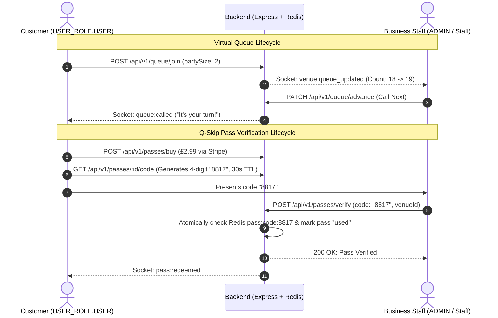

# Unified Backend Design Document: Business & Customer Roles

> **Figma Source Reference**
> - **File Key**: `bs3oUW2eAP4EYMftGOzQBK`
> - **Business Frame (Current Role)**: Node ID `40006002:4414` (`App Design - Business`)
> - **Customer Frame (Previous Role)**: Node ID `40003001:15707` (`App Design - Customer`)

---

## 1. Executive Summary & Role Comparison

This document unifies the architecture of the two interconnected sides of the platform:
1. **Business / Vendor Role** (`App Design - Business`, `40006002:4414`): Operator-facing dashboard for venue management, real-time queue advancement, Q-Skip pass verification, table setup, staff permissions, and menu catalog management.
2. **Customer / End-User Role** (`App Design - Customer`, `40003001:15707`): Consumer-facing mobile app for venue discovery, virtual queue entry, Q-Skip pass purchases with 30-second rotating codes, table reservations, and loyalty rewards.

### 1.1. Interaction Sequence Diagram



### 1.2. Role Comparison Matrix

| Dimension | Customer Role (`40003001:15707`) | Business / Vendor Role (`40006002:4414`) |
| :--- | :--- | :--- |
| **System Role** | `USER_ROLE.USER` (`'user'`) | `USER_ROLE.ADMIN` (`'admin'`), `SUPER_ADMIN` + Venue Sub-Roles (`Manager`, `Staff`, `Queue Updater`) |
| **Primary Intent** | Consumer & Participant | Operator, Validator & Content Manager |
| **Queue Operations** | Joins queue, tracks live position (`#7`), leaves queue | Opens/closes queue, sets wait time, sets table count, calls next party, monitors accuracy score (`87%`) |
| **Pass Operations** | Buys pass (£2.99), displays rolling code (`8817`) with 30s countdown | Enters customer's 4-digit code in `Verify Code` screen to redeem |
| **Reservation** | Selects date, time slot, party size, submits booking | Toggles `Accept Reservation`, views confirmed bookings in activity feed |
| **Menu & Categories**| Read-only browsing (`Burgers`, `Sides`, `Drinks`, `Desert`) | Full CRUD: Creates category, adds items with photo uploads and AI auto-fill, toggles status |
| **Analytics & Team** | Views own points wallet (`1250 pts`) and redemption history | Views venue revenue (£849.16), passes sold (284), team management, recent activity log |

---

## 2. Zero-Duplication Shared Entity Architecture

> [!IMPORTANT]
> Both roles operate on the **exact same core data models** with strictly partitioned RBAC permissions and routes. No duplicate models are created.

```
Existing Project Models          New Shared Modules                 Role-Specific Modules
┌─────────────────────────┐     ┌────────────────────────────┐     ┌────────────────────────────┐
│ • User (Auth, Profiles) │ ──► │ • Venue (Business Profile) │ ──► │ • VenueStaff (Sub-roles)   │
│ • Category (Catalog)    │     │ • QueueEntry (Live line)   │     │ • VenueActivity (Feed)     │
│ • MenuItem (Menu items) │     │ • QSkipPass (Passes)       │     │ • PointsWallet (Customer)  │
│                         │     │ • Reservation (Bookings)   │     │                            │
└─────────────────────────┘     └────────────────────────────┘     └────────────────────────────┘
```

1. **`Category`**: Managed by Business (`POST`, `PATCH`, `DELETE`); consumed by Customer (`GET`).
2. **`MenuItem`**: Managed by Business (`POST`, `PATCH`, `DELETE`, AI Fill); consumed by Customer (`GET`).
3. **`QueueEntry`**: Customer enters line (`status: 'waiting'`); Business advances/admits (`status: 'called' | 'admitted'`).
4. **`QSkipPass`**: Customer purchases; Customer generates 30s rolling code; Business redeems code on `Verify Code` screen (`status: 'used'`).
5. **`Reservation`**: Customer creates booking; Business confirms/seats and toggles venue acceptance.
6. **`Venue`**: Holds operational settings (capacity, wait times, hours) shared by both roles.

---

## 3. Role-Based Access Control (RBAC) & Sub-Roles

### 3.1. Staff Sub-Roles
From the `Teams` screen (`40006291:3713`), the Business role supports three granular staff roles:
- **`Manager`**: Full venue operations, table capacity, team member management, and financial revenue viewing.
- **`Staff`**: Pass verification, table seating, and queue advancement.
- **`Queue Updater`**: Dedicated permission to adjust queue size and estimated wait times.

### 3.2. Granular Permissions Table

| Action | Customer (`USER`) | Queue Updater | Staff | Manager / Admin | Super Admin |
| :--- | :---: | :---: | :---: | :---: | :---: |
| Join / Leave Queue | ✅ | ❌ | ❌ | ❌ | ❌ |
| Buy Pass / View Code | ✅ | ❌ | ❌ | ❌ | ❌ |
| Book Reservation | ✅ | ❌ | ❌ | ❌ | ❌ |
| Verify Pass Code (`8817`) | ❌ | ❌ | ✅ | ✅ | ✅ |
| Update Queue Size / ETA | ❌ | ✅ | ✅ | ✅ | ✅ |
| Set Total Tables / Capacity | ❌ | ❌ | ❌ | ✅ | ✅ |
| Toggle Queue Open / Closed | ❌ | ❌ | ❌ | ✅ | ✅ |
| Manage Menu & Categories | ❌ | ❌ | ❌ | ✅ | ✅ |
| Add / Remove Team Members | ❌ | ❌ | ❌ | ✅ | ✅ |
| View Financial Revenue | ❌ | ❌ | ❌ | ✅ | ✅ |

---

## 4. UI Screen & Component Breakdown (`App Design - Business`)

### 4.1. Menu Management (`Menu`: `40006242:5420` & `Menu- Modal`: `40006250:9183`)
- **Table Columns**: `ID`, `Image`, `Item Name`, `Category`, `Price`, `Status` (Active/Inactive), `Action`.
- **"Add Menu Item" Modal Form**:
  - `Item Name`: Text input (placeholder `"Enter category title"`).
  - `Category`: Dropdown / select (placeholder `"Enter category"`).
  - `Price`: Number input (placeholder `"Enter menu price"`).
  - `Image`: File upload button (`"Click to upload"` - `PNG or JPEG`).
  - `"Fill with AI"` button for AI-assisted auto-generation.
  - Submit: `"Add Item"` | Dismiss: `"Cancel"`.

### 4.2. Queue Control & Table Settings (`Queue Control`: `40006225:255` & `Modal`: `40006680:6530`)
- **Queue Metrics**: `Queue Size: 18 people`, `Estimated Wait Time: 10 min`, `Tables occupied: 10/24 tables`.
- **Toggles**: `Queue status: Open / Closed`, `Accept Reservation: On / Off`.
- **Actions**: `"Set total"` (opens "Set Table" modal: `"Enter Total Table" -> "Update"`), `"Update Queue"`.
- **Recent Activity Feed**:
  - `"Q Skip Pass Used at 11:30 AM"`
  - `"Queue updated to 18 people"`
  - `"Q Skip Pass sold"`
  - `"Reservation confirmed for 7 PM"`

### 4.3. Pass Verification Screen (`Verify Code`: `40006232:1836`)
- **Description**: `"Enter the 4-digit code given by the customer."`
- **Inputs**: 4-digit numeric pin inputs (`8` `8` `1` `7`).
- **Action**: `"Verify"` button.
- **Error State (`40006234:5160`)**: Handles expired, invalid, or already-used codes.

### 4.4. Live View & Telemetry (`Live View`: `40006227:5206`)
- **Metrics**: `Queue Accuracy Score: 87%`, `People in Queue: 24 people (Live Count)`, `Queue Trend: Increasing (+6 in last 10 min)`, `Peak time today: 12:00 - 14:00`.

### 4.5. Team Management (`Teams`: `40006291:3713` & `Modal`: `40007264:9350`)
- **Staff Table**: `Name`, `Email`, `Role` (`Manager`, `Staff`, `Queue Updater`), `Actions`.
- **"Add Member" Modal**: Inputs for `Member Name`, `Email`, `Role` selector, `"Add Member"` submit button.

### 4.6. Revenue & Analytics (`Earnings`: `40006238:5301`)
- **KPIs**: `Passes sold (All Time): 284`, `Total Earnings: £849.16`.
- **Timeline Chart**: Monthly revenue curve (`Jan` - `Dec`).

---

## 5. TypeScript Interfaces & Data Models

```typescript
import { Model, Types } from 'mongoose';

// ==========================================
// 1. Venue Model Interface
// ==========================================
export interface IVenue {
  _id?: Types.ObjectId | string;
  adminId: Types.ObjectId | string;   // Owner reference
  name: string;                       // e.g. "Burger House"
  address: string;
  location?: { lat: number; lng: number };
  queueStatus: 'open' | 'closed';
  acceptReservations: boolean;
  totalTables: number;                // Set via "Set Table" modal (e.g. 24)
  occupiedTables: number;             // e.g. 10
  currentQueueSize: number;           // e.g. 18
  estimatedWaitMinutes: number;       // e.g. 10
  accuracyScore: number;              // e.g. 87 (%)
  qSkipPassPrice: number;             // e.g. 2.99
  currency: string;                   // 'GBP'
  openingHours?: Record<string, string>;
  isDeleted?: boolean;
  createdAt?: Date;
  updatedAt?: Date;
}

export type VenueModel = Model<IVenue>;

// ==========================================
// 2. Venue Staff Interface
// ==========================================
export type TVenueStaffRole = 'manager' | 'staff' | 'queue_updater';

export interface IVenueStaff {
  _id?: Types.ObjectId | string;
  venueId: Types.ObjectId | string;
  userId?: Types.ObjectId | string;
  name: string;
  email: string;
  role: TVenueStaffRole;
  isDeleted?: boolean;
}

// ==========================================
// 3. Menu Item Interface
// ==========================================
export interface IMenuItem {
  _id?: Types.ObjectId | string;
  venueId?: Types.ObjectId | string;
  itemCode?: string;                  // e.g. "0001"
  name: string;                       // e.g. "Smash Burger"
  category: Types.ObjectId | string;  // Reference to Category
  price: number;                      // e.g. 9.49
  currency: string;                   // 'GBP'
  image: string;                      // CDN / static file URL
  status: 'active' | 'inactive';
  isDeleted?: boolean;
}

// ==========================================
// 4. Q-Skip Pass Verification DTO
// ==========================================
export interface IVerifyPassDTO {
  code: string;                       // 4-digit code e.g. "8817"
  venueId: string;
}

export interface IVerifyPassResponse {
  success: boolean;
  message: string;
  pass: {
    id: string;
    customerName: string;
    verifiedAt: Date;
    benefits: string[];
  };
}

// ==========================================
// 5. Activity Log Interface
// ==========================================
export interface IVenueActivity {
  _id?: Types.ObjectId | string;
  venueId: Types.ObjectId | string;
  type: 'pass_used' | 'queue_updated' | 'pass_sold' | 'reservation_confirmed';
  title: string;                      // e.g. "Q Skip Pass Used"
  detail?: string;                    // e.g. "Queue updated to 18 people"
  timestamp: Date;
}
```

---

## 6. REST API Endpoint Specifications (Strict Layering)

### 6.1. Venue & Operations Endpoints (`/api/v1/venues`)
| Method | Route | Access | Description |
| :--- | :--- | :--- | :--- |
| `GET` | `/my-venue` | `ADMIN` | Get authenticated admin's venue details |
| `PATCH`| `/queue-control` | `ADMIN, STAFF, QUEUE_UPDATER` | Update queue size, wait time, and open/closed state |
| `PATCH`| `/tables` | `ADMIN, MANAGER` | Update total tables capacity (Set Table modal) |
| `GET` | `/live-view` | `ADMIN, STAFF` | Real-time live count, accuracy score, and trend |
| `GET` | `/activity-feed` | `ADMIN, STAFF` | Recent venue activity list |
| `GET` | `/analytics/earnings` | `ADMIN, MANAGER`| Revenue summary and pass sales metrics |

### 6.2. Pass Verification Endpoints (`/api/v1/passes`)
| Method | Route | Access | Description |
| :--- | :--- | :--- | :--- |
| `POST` | `/verify` | `ADMIN, STAFF` | Validates customer's 4-digit code and marks pass `used` |

### 6.3. Menu Item Management Endpoints (`/api/v1/menu`)
| Method | Route | Access | Description |
| :--- | :--- | :--- | :--- |
| `POST` | `/create` | `ADMIN, MANAGER` | Add menu item with photo upload |
| `GET` | `/` | `Public, USER, ADMIN` | Get menu items with search, filter, pagination |
| `GET` | `/:id` | `Public, USER, ADMIN` | Get single menu item |
| `PATCH`| `/update/:id` | `ADMIN, MANAGER` | Update menu item details or photo |
| `DELETE`| `/delete/:id` | `ADMIN, MANAGER` | Soft-delete menu item |
| `POST` | `/fill-with-ai` | `ADMIN, MANAGER` | Auto-fill menu details using Gemini AI |

### 6.4. Team Management Endpoints (`/api/v1/venues/members`)
| Method | Route | Access | Description |
| :--- | :--- | :--- | :--- |
| `GET` | `/` | `ADMIN, MANAGER` | List all staff members and roles |
| `POST` | `/add` | `ADMIN, MANAGER` | Add new staff member with assigned role |
| `DELETE`| `/:id` | `ADMIN, MANAGER` | Remove staff member |

---

## 7. Real-time WebSockets & Redis Architecture

### 7.1. 4-Digit Pass Verification Flow
1. When customer opens active pass, code `8817` is stored in Redis:
   ```typescript
   await RedisService.set(`pass:code:${venueId}:${code}`, passId, 30);
   ```
2. When staff submits `8817` via `POST /api/v1/passes/verify`:
   - Backend queries Redis `pass:code:${venueId}:${code}` in < 2ms.
   - If present, atomically deletes key and updates MongoDB `status: 'used'`.
   - Emits Socket event `pass:redeemed` to customer.

### 7.2. Real-Time Queue Sync
- When Business updates queue size or wait time:
  - Broadcasts `venue:queue_updated` to all customers viewing the venue.
  - When customer is called, emits `queue:called` directly to customer's socket room.
